# car-wash-life
> 셀프세차에 관심이 있는 사람들을 위한 서비스

### Project Spec

`Java 21` `Spring Boot 4.x` `PostgreSQL`

### ERD



실선은 DB 외래키, 점선은 DB 외래키 없이 ID 값으로 연결하는 관계입니다.

[자세한 ERD 보러가기 →](https://github.com/f-lab-edu/car-wash-life/wiki/ERD)

### 패키지 구조

```text
com.carwashlife
├── application
│   └── {domain}
│       ├── api
│       ├── domain
│       └── service
├── infrastructure
│   ├── persistence
│   ├── client
│   └── ...
└── common
    ├── config
    ├── exception
    └── ...
```

### API 계약

- [세차장 등록·수정·상세 조회의 제보와 신뢰도 의미](docs/api/car-wash.md)
- [사진 업로드와 저장 경로 설정](docs/car-wash-mvp.md)
