[ERD 크게 보기](detailed.svg)

### members · [Member](https://github.com/f-lab-edu/car-wash-life/blob/9dcf9c0c7bf334fd36020dbf1736b6f15ee44c7b/src/main/java/me/ngyu/carwashlife/application/member/domain/Member.java)

회원의 계정과 상태를 관리한다. 제보와 사진에는 회원 ID를 저장해 작성자와 업로더를 식별한다.

### car_wash · [CarWash](https://github.com/f-lab-edu/car-wash-life/blob/9dcf9c0c7bf334fd36020dbf1736b6f15ee44c7b/src/main/java/me/ngyu/carwashlife/application/carwash/domain/CarWash.java)

세차장의 대표 이름과 좌표를 저장한다. 여러 제보 중 대표 제보 하나를 참조해 조회에 사용할 상세 정보를 정한다.

### car_wash_history · [CarWashHistory](https://github.com/f-lab-edu/car-wash-life/blob/9dcf9c0c7bf334fd36020dbf1736b6f15ee44c7b/src/main/java/me/ngyu/carwashlife/application/carwash/domain/CarWashHistory.java)

등록·수정 당시의 세차장 정보를 보존한다. 소속 세차장과 수정 기준 제보를 연결해 변경 이력과 정보의 출처를 추적한다.

### car_wash_photo · [CarWashPhoto](https://github.com/f-lab-edu/car-wash-life/blob/9dcf9c0c7bf334fd36020dbf1736b6f15ee44c7b/src/main/java/me/ngyu/carwashlife/application/carwash/domain/CarWashPhoto.java)

사진의 파일 정보와 업로드한 회원 ID를 저장한다. 최초 첨부 제보와 연결해 사진의 제출 출처를 보존한다.
